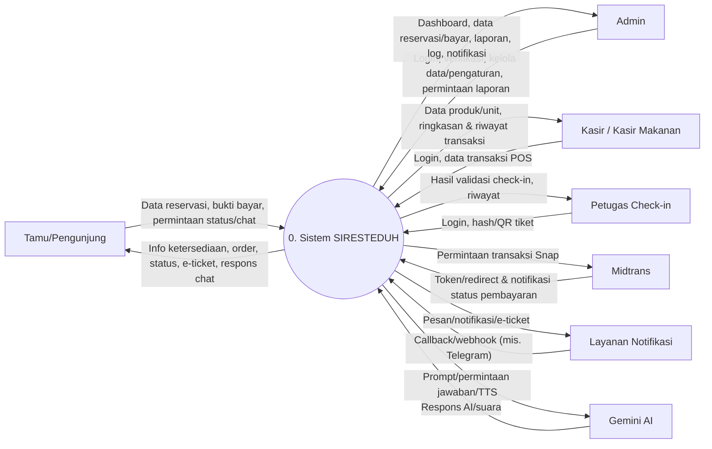
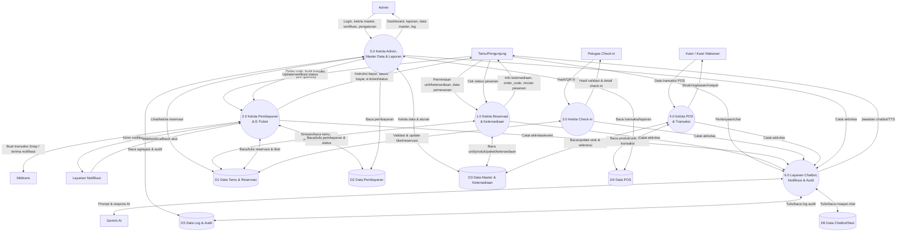
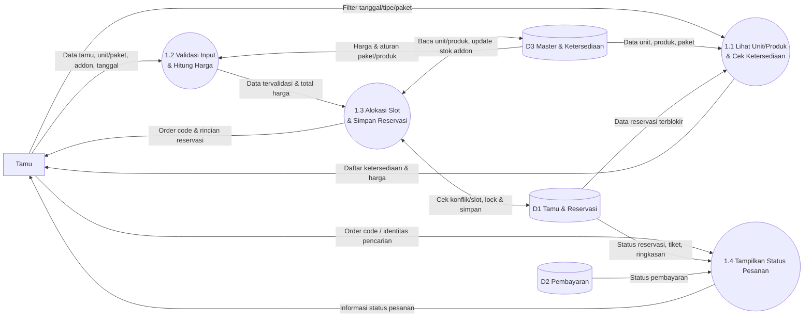
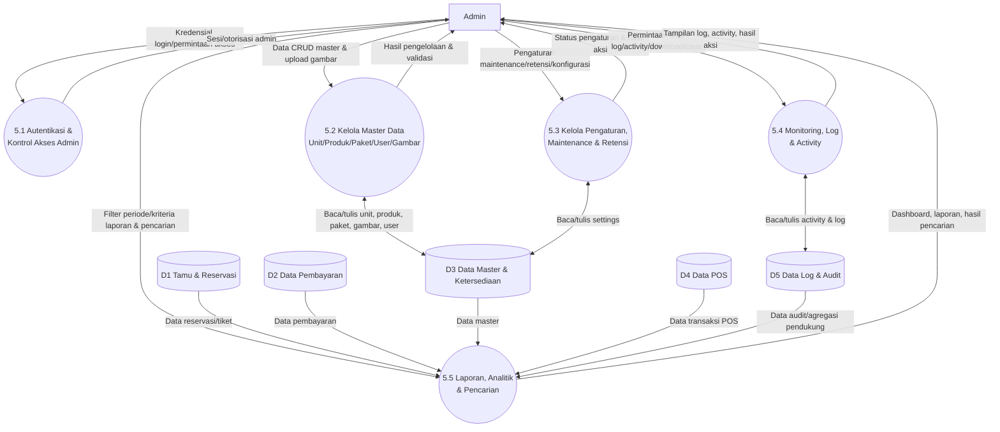

# DFD (Data Flow Diagram) — SIRESTEDUH

Dokumen DFD sistem **SIRESTEDUH** (konteks, level 1, dan dekomposisi level 2 untuk proses utama). Diagram menggunakan Mermaid agar mudah dirender di GitHub.

## Entitas Eksternal

| Kode | Entitas | Deskripsi |
|---|---|---|
| E1 | Tamu/Pengunjung | Pengguna publik yang melakukan reservasi, pembayaran, cek status, dan menerima e-ticket |
| E2 | Admin | Pengelola sistem: verifikasi, master data, laporan, pengaturan, monitoring |
| E3 | Kasir / Kasir Makanan | Petugas POS yang mencatat transaksi penjualan |
| E4 | Petugas Check-in | Petugas validasi/pemindaian e-ticket QR |
| E5 | Midtrans | Payment gateway (pembuatan transaksi Snap & notifikasi pembayaran) |
| E6 | Layanan Notifikasi (Telegram/Fonnte/Email*) | Kanal pengiriman notifikasi/e-ticket sesuai konfigurasi |
| E7 | Gemini AI | Layanan chatbot/TTS (opsional, jika dikonfigurasi) |

\*Email bergantung konfigurasi mail.

## Data Store (Penyimpanan Data)

| Kode | Data Store | Keterangan |
|---|---|---|
| D1 | Data Tamu & Reservasi | `visitors`, `reservations`, `reservation_addons`, `tickets` |
| D2 | Data Pembayaran | `payments`, file bukti (storage private) |
| D3 | Data Master & Ketersediaan | `units`, `products`, `images`, `glamping_packages`, `aula_packages`, `settings` |
| D4 | Data POS | `pos_transactions`, `pos_transaction_details` |
| D5 | Data Log & Audit | `activity_logs`, log aplikasi |
| D6 | Data Chatbot/Sesi | `chatbot_messages`, sesi/token terkait |

---

## DFD Level 0 — Diagram Konteks



---

## DFD Level 1 — Dekomposisi Proses



---

## DFD Level 2 — Proses 1.0 Kelola Reservasi & Ketersediaan



## DFD Level 2 — Proses 2.0 Kelola Pembayaran & E-Ticket

```mermaid
flowchart TB
    E1[Tamu]
    E2[Admin]
    E5[Midtrans]
    E6[Layanan Notifikasi]
    D1[(D1 Tamu & Reservasi)]
    D2[(D2 Data Pembayaran)]

    P21((2.1 Tampilkan Info Pembayaran))
    P22((2.2 Unggah Bukti Transfer Manual))
    P23((2.3 Buat & Proses Pembayaran Gateway))
    P24((2.4 Verifikasi Admin / Aksi Notifikasi))
    P25((2.5 Terbitkan & Kirim E-Ticket))

    E1 -->|Order code| P21
    D1 -->|Data reservasi| P21
    D2 -->|Status & info pembayaran| P21
    P21 -->|Rincian tagihan & metode bayar| E1

    E1 -->|Bukti transfer (gambar)| P22
    P22 -->|Simpan bukti & set waiting_verification| D2
    P22 -->|Update status reservasi| D1
    P22 -->|Notifikasi verifikasi| E6

    E1 -->|Permintaan bayar otomatis| P23
    P23 -->|Permintaan transaksi Snap| E5
    E5 -->|Token/redirect| P23
    E5 -->|Notifikasi status (signed)| P23
    P23 -->|Simpan/update status pembayaran gateway| D2
    P23 -->|Update status reservasi (jika lunas)| D1

    E2 -->|Setujui/Tolak| P24
    E6 -->|Callback aksi (Telegram, jika dipakai)| P24
    P24 -->|Update status verifikasi/tolak/batal| D2
    P24 -->|Update status reservasi| D1

    P23 -->|Trigger jika lunas| P25
    P24 -->|Trigger jika diverifikasi| P25
    P25 -->|Buat/ambil tiket (hash QR)| D1
    P25 -->|Kirim e-ticket/notifikasi| E6
```

## DFD Level 2 — Proses 3.0 Kelola Check-in

```mermaid
flowchart LR
    E4[Petugas Check-in]
    D1[(D1 Tamu & Reservasi)]
    D5[(D5 Log & Audit)]

    P31((3.1 Terima Input Hash/QR))
    P32((3.2 Validasi Tiket & Otorisasi))
    P33((3.3 Cek Konflik Jadwal/Slot))
    P34((3.4 Tandai Digunakan & Catat Hasil))

    E4 -->|Scan/masukkan hash QR| P31
    P31 -->|Hash tervalidasi format| P32
    P32 <-->|Ambil tiket & reservasi| D1
    P32 -->|Status tiket (valid/used/invalid)| P34
    P32 -->|Data reservasi & unit/jadwal| P33
    D1 -->|Reservasi aktif/slot terkait| P33
    P33 -->|Hasil cek bentrok| P34
    P34 -->|Update used_at, is_used, waktu aktual| D1
    P34 -->|Catat event check-in| D5
    P34 -->|Hasil check-in & detail tamu/unit| E4
```

## DFD Level 2 — Proses 4.0 Kelola POS & Transaksi

```mermaid
flowchart LR
    E3[Kasir / Kasir Makanan]
    D3[(D3 Master & Ketersediaan)]
    D4[(D4 Data POS)]
    D1[(D1 Tamu & Reservasi)]

    P41((4.1 Muat Produk/Unit Sesuai Peran))
    P42((4.2 Validasi Item, Stok & Harga))
    P43((4.3 Proses Checkout & Simpan Transaksi))
    P44((4.4 Tampilkan Riwayat & Ringkasan))

    E3 -->|Permintaan daftar jual| P41
    D3 -->|Produk/unit/paket| P41
    P41 -->|Daftar item yang diizinkan| E3

    E3 -->|Item, qty, metode bayar| P42
    D3 -->|Stok/harga/aturan| P42
    D1 -->|Cek slot/jadwal (jika sewa paket/unit)| P42
    P42 -->|Item valid & total| P43

    P43 -->|Simpan transaksi & detail| D4
    P43 <-->|Update stok/slot terkait| D3
    P43 -->|Bukti/ringkasan transaksi| E3

    E3 -->|Filter periode| P44
    D4 -->|Riwayat & agregasi transaksi| P44
    P44 -->|Riwayat, rekap, item terjual| E3
```

## DFD Level 2 — Proses 5.0 Kelola Admin, Master Data & Laporan



## DFD Level 2 — Proses 6.0 Layanan Chatbot, Notifikasi & Audit

```mermaid
flowchart TB
    E1[Tamu/Pengunjung]
    E2[Admin]
    E5[Midtrans]
    E6[Layanan Notifikasi]
    E7[Gemini AI]
    D1[(D1 Tamu & Reservasi)]
    D2[(D2 Data Pembayaran)]
    D5[(D5 Data Log & Audit)]
    D6[(D6 Data Chatbot/Sesi)]

    P61((6.1 Proses Chatbot & TTS))
    P62((6.2 Kelola Notifikasi\n& Webhook))
    P63((6.3 Pencatatan Audit,\nActivity & Pruning))

    E1 -->|Pertanyaan/pesan chat, permintaan suara| P61
    P61 <-->|Baca konteks & simpan riwayat pesan| D6
    P61 <-->|Prompt & respons AI/TTS| E7
    P61 -->|Jawaban chatbot/hasil suara| E1

    D1 -->|Event reservasi/tiket| P62
    D2 -->|Event/status pembayaran| P62
    E2 -->|Aksi kirim/resend e-ticket| P62
    P62 -->|Kirim e-ticket/notifikasi| E6
    E6 -->|Webhook/callback (Telegram)| P62
    E5 -->|Notifikasi pembayaran (diteruskan dari 2.0)| P62
    P62 -->|Hasil pemrosesan webhook/aksi| E2

    E1 -->|Aktivitas pengguna publik| P63
    E2 -->|Aktivitas admin| P63
    P62 -->|Event notifikasi/webhook| P63
    P61 -->|Event chatbot| P63
    P63 <-->|Tulis/baca/prune activity & log| D5
    P63 -->|Informasi audit untuk monitoring| E2
```

## Keterangan Kelengkapan DFD

- **Level 0 (Konteks):** menggambarkan sistem SIRESTEDUH sebagai satu proses dengan seluruh entitas eksternal dan aliran data utama.
- **Level 1:** dekomposisi ke 6 proses utama (Reservasi & Ketersediaan, Pembayaran & E-Ticket, Check-in, POS, Admin/Master/Laporan, Chatbot/Notifikasi/Audit).
- **Level 2:** rincian subproses untuk seluruh proses utama (1.0–6.0) beserta interaksi ke data store dan entitas eksternal terkait.
