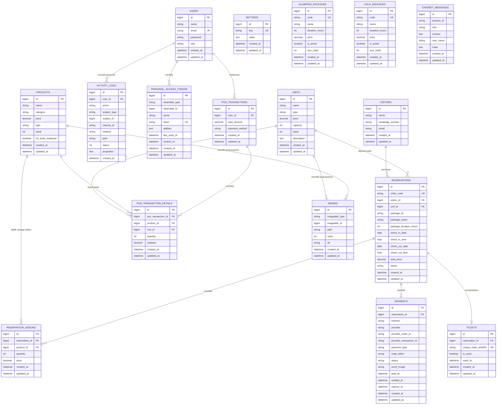

# ERD (Entity Relationship Diagram) — SIRESTEDUH

Diagram relasi entitas berdasarkan model, relasi Eloquent, dan skema database aplikasi.

> Render otomatis di GitHub (Mermaid). Fokus pada entitas bisnis & operasional inti.

## ERD Utama

## Catatan Relasi

| Relasi | Kardinalitas | Penjelasan |
|---|---|---|
| Visitor — Reservation | 1 : N | Satu tamu dapat memiliki banyak reservasi. |
| Unit — Reservation | 1 : N (opsional) | Reservasi dapat terkait ke satu unit; `unit_id` dapat null pada kasus tertentu sesuai alur. |
| Reservation — Reservation Addon | 1 : N | Satu reservasi dapat memiliki banyak item tambahan. |
| Product — Reservation Addon | 1 : N | Produk (addon) dapat dipakai pada banyak addon reservasi. |
| Reservation — Payment | 1 : 0..1 | Setiap reservasi memiliki maksimal satu data pembayaran aktif terkait. |
| Reservation — Ticket | 1 : 0..1 | E-ticket dibuat/terkait untuk reservasi yang valid/terbayar sesuai alur. |
| User — Pos Transaction | 1 : N | Kasir/petugas mencatat transaksi POS. |
| Pos Transaction — Pos Transaction Detail | 1 : N | Satu transaksi terdiri dari banyak baris item. |
| Product/Unit — Pos Transaction Detail | 1 : N (opsional) | Detail dapat merujuk ke produk atau unit. |
| Unit/Product — Image | 1 : N (polymorphic) | Gambar dapat dimiliki oleh unit atau produk. |
| User — Activity Log | 1 : N (opsional) | Aktivitas dapat terkait user login atau tamu (user null). |

## Entitas Referensi Paket

- **`glamping_packages`** dan **`aula_packages`** menyimpan master paket (kode, durasi, harga, status aktif).
- Pada `reservations`, informasi paket yang dipilih dapat disalin/disimpan (`package_id`, `package_name`, `package_duration_hours`) untuk menjaga konsistensi historis pesanan.
