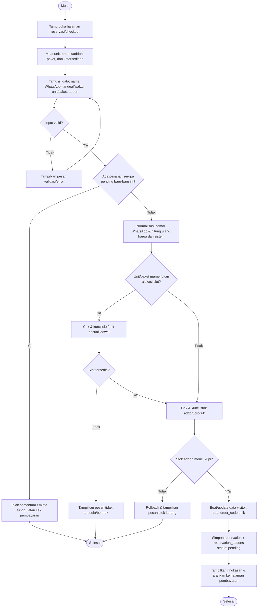
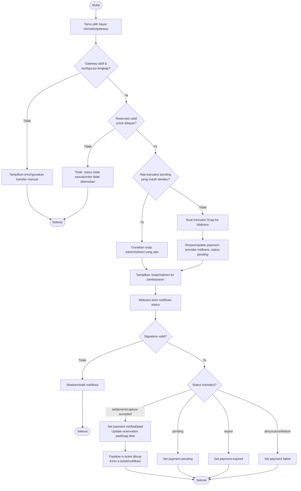
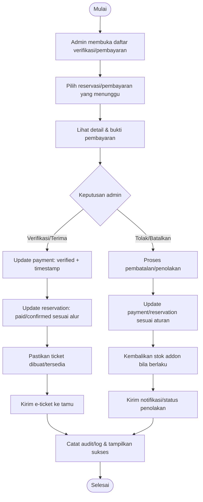
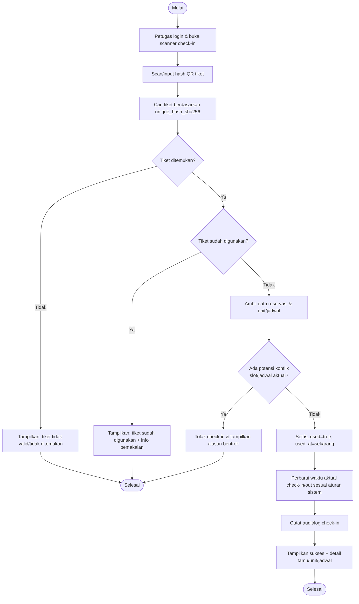
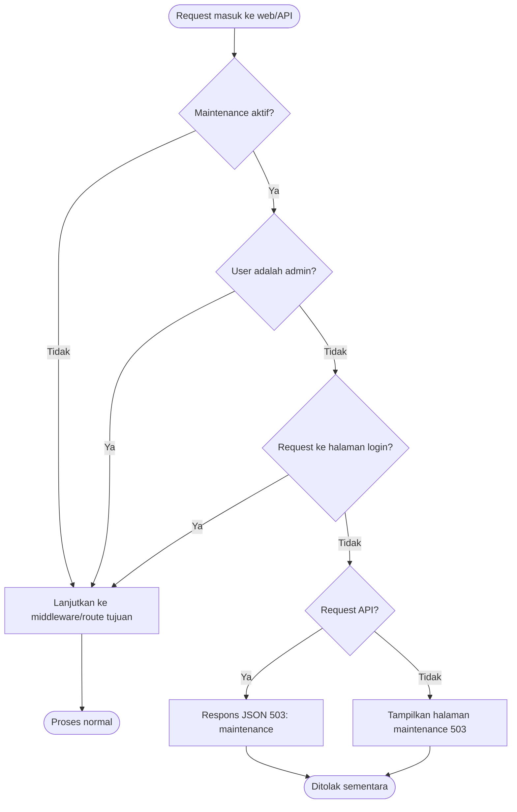

# Flowchart — SIRESTEDUH

Kumpulan flowchart alur proses utama sistem **SIRESTEDUH**. Diagram menggunakan Mermaid (render di GitHub).

---

## 1. Flowchart Reservasi Tamu (Checkout)



---

## 2. Flowchart Pembayaran — Transfer Manual (Upload Bukti)

```mermaid
flowchart TD
    A([Mulai]) --> B[Tamu buka halaman pembayaran dengan order_code]
    B --> C[Sistem tampilkan rincian reservasi & status pembayaran]
    C --> D{Status reservasi\nboleh upload bukti?}
    D -- Tidak --> D1[Tampilkan info: tidak dapat menerima bukti]
    D1 --> Z1([Selesai])
    D -- Ya --> E[Tamu unggah file bukti gambar]
    E --> F{Validasi file\n(format/ukuran) lolos?}
    F -- Tidak --> F1[Tampilkan error validasi]
    F1 --> E
    F -- Ya --> G[Simpan file ke storage private]
    G --> H[Update/buat payment: manual_transfer, status pending]
    H --> I[Update reservation: waiting_verification]
    I --> J[Kirim notifikasi verifikasi (sesuai konfigurasi)]
    J --> K[Tampilkan pesan menunggu verifikasi admin]
    K --> Z2([Selesai])
```

---

## 3. Flowchart Pembayaran — Midtrans (Gateway Otomatis)



---

## 4. Flowchart Verifikasi Pembayaran oleh Admin



---

## 5. Flowchart Check-in E-Ticket (Petugas)



---

## 6. Flowchart Transaksi POS (Kasir / Kasir Makanan)

```mermaid
flowchart TD
    A([Mulai]) --> B[Kasir login sesuai peran]
    B --> C[Sistem muat item yang diizinkan\n(kasir umum / kasir makanan / check-in)]
    C --> D[Kasir pilih item, jumlah, metode bayar]
    D --> E{Item & kuantitas valid?}
    E -- Tidak --> E1[Tampilkan error validasi]
    E1 --> D
    E -- Ya --> F{Metode bayar diizinkan\nuntuk peran?}
    F -- Tidak --> F1[Tolak metode bayar]
    F1 --> D
    F -- Ya --> G[Cek stok/harga & ketersediaan slot jika sewa unit/paket]
    G --> H{Stok/slot mencukupi?}
    H -- Tidak --> H1[Rollback/tolak: stok/slot tidak cukup]
    H1 --> Z1([Selesai])
    H -- Ya --> I[Hitung total & simpan pos_transaction + details]
    I --> J[Perbarui stok/atribut terkait sesuai aturan]
    J --> K[Catat audit/log bila berlaku]
    K --> L[Tampilkan struk/ringkasan transaksi]
    L --> Z2([Selesai])
```

---

## 7. Flowchart Mode Maintenance & Akses Sistem


